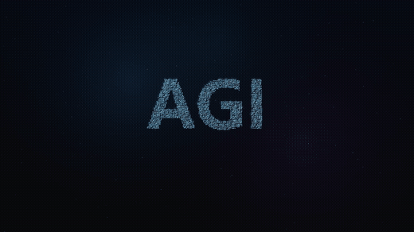
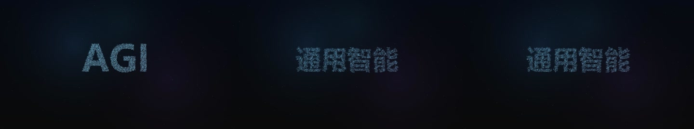

# DeepSeek · Particle Typography

Particles form four keywords in sequence for concept introductions, feature lists and opening slogans.

**16:9 · 1920 × 1080 · 30 fps · v1.1.0** · [@thepandaq](https://motiongit.com/@thepandaq) · [简体中文](README.zh-CN.md)

**[Template details, full .motion & demo](https://motiongit.com/@thepandaq/deepseek-word-morph)**
https://motiongit.com/@thepandaq/deepseek-word-morph

Demo available; template download coming soon.

## Demo

[Full demo](https://motiongit.com/@thepandaq/deepseek-word-morph) · [Play video](https://media.openaicut.com/previews/630/1.1.0-7b16186bd6b2.mp4)

## How it works

- Declared runtime profile: html-canvas/1.
- Editable inputs are mapped through the template parameter schema and preset to its existing animation project.
- The declared timeline has a fixed duration; new content fits its existing scene order and timing.

Demo duration: **9s**. The documented output is 1920 × 1080, 30 fps. The public demo is 9 seconds. Use the actual package parameter bounds; extra materials do not automatically create extra scenes.

## Inputs and materials

- **Required:** Word1: text, up to 6 characters.
- **Required:** Word2: text, up to 6 characters.
- **Required:** Word3: text, up to 6 characters.
- **Required:** Word4: text, up to 6 characters.
- **Optional:** Accent: text.

Useful for: Particles form four keywords in sequence for concept introductions, feature lists and opening slogans.

## Runtime requirements

- Declared runtime profile: html-canvas/1. Check the downloaded package for exact tools and setup steps.
- Use the package dependency lock and setup/check instructions. Check existing tools first, install only missing requirements and verify a preview.

## Use the template

1. Obtain the current .motion package from the [template page](https://motiongit.com/@thepandaq/deepseek-word-morph).
2. Extract or load it as documented, then read the included README and referenced production guide.
3. Use your own content and materials, reuse the working environment, and follow the package entry point to inspect a real preview.

You can give an assistant the repository URL and this request:

> https://github.com/motiontemplates/941301
>
> Use this .motion template with my content. Obtain the package from https://motiongit.com/@thepandaq/deepseek-word-morph, extract or load it as documented, read the included README and referenced guide, reuse my working environment, and follow the package workflow to show an actual preview.

## .motion format

MotionGit .motion is a reusable video-template format that organizes the animation project, parameters, assets, dependencies and production guide. Its runtime uses new content to produce a finished video. [Format documentation](https://motiongit.com/spec)

[Versions, license & full download](https://motiongit.com/@thepandaq/deepseek-word-morph) · [Production reference](ASSISTANT.md)
